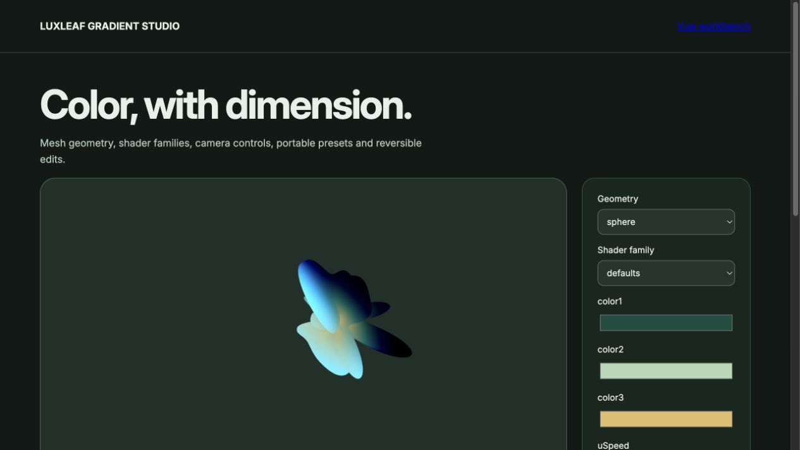

# LuxLeaf Gradient Studio

**Create moving gradients in React and Vue, with mesh geometry, shader controls and portable presets.**

[Quick start](#quick-start) · [Examples](#examples) · [API guide](#api-guide) · [Run the demos](#run-the-demos) · [Documentation](#documentation)



*Actual package workbench. [View its source](demo/advanced.tsx); run `/advanced.html` using the instructions below. This is a screenshot, not a hosted live demo.*

## At a glance

- A compact canvas renderer plus separate React and Vue mesh-renderer entry points.
- Plane, water-plane and sphere geometry across four shader families in the mesh studio.
- Color, camera, motion and grain controls.
- Validated presets, URL sharing, undo/redo and editor integration source.

**Release covered:** `@zontafor/luxleaf-gradient-studio@0.2.0` on `main`. [PR #1](https://github.com/Zontafor/luxleaf-gradient-studio/pull/1) contains newer work; its [source-branch guide](https://github.com/Zontafor/luxleaf-gradient-studio/blob/faithful-upstream/LUXLEAF.md) uses the APIs available on that branch. The examples below use the published package, unless explicitly labeled otherwise.

## Quick start

Node 24+ for this repository; React 19 for the React examples or Vue 3 for the Vue example. Browser rendering requires WebGL. Give the canvas a sized container.

### Install in an application

Configure GitHub Packages authentication as described in the [release and registry guide](docs/RELEASING.md). Scope the registry to LuxLeaf so other dependencies continue to resolve from their normal registry:

```sh
npm config set @zontafor:registry https://npm.pkg.github.com --location=project
npm install @zontafor/luxleaf-gradient-studio@0.2.0
```

Keep credentials outside committed source. [GitHub Releases](https://github.com/Zontafor/luxleaf-gradient-studio/releases) also provide package archives; downloading an archive is separate from installing through the registry.

### Try the repository locally

```sh
git clone https://github.com/Zontafor/luxleaf-gradient-studio.git
cd luxleaf-gradient-studio
npm ci --ignore-scripts
npm run build
npm run dev
```

Open the local address printed by Vite. React examples below belong in a React/TypeScript application; plain TypeScript examples run in a browser with a bundler.

## Examples

### Animated React background

```tsx
import { GradientCanvas } from '@zontafor/luxleaf-gradient-studio';

export function HeroBackground() {
  return (
    <GradientCanvas
      label="Green and gold animated gradient"
      options={{ colors: ['#102a22', '#77b299', '#e4c477'], speed: 0.25, warp: 0.7 }}
      style={{ display: 'block', width: '100%', height: 360 }}
    />
  );
}
```

The root entry point uses LuxLeaf options such as `colors`, `warp` and `shape: "orb"`. It manages its renderer lifecycle through the React component.

### React mesh gradient

```tsx
import { ShaderGradientCanvas, ShaderGradient } from '@zontafor/luxleaf-gradient-studio/react';

export function MeshBackground() {
  return (
    <div style={{ height: 420 }}>
      <ShaderGradientCanvas style={{ width: '100%', height: '100%' }} pixelDensity={1.5}>
        <ShaderGradient
          type="waterPlane" shader="defaults" animate="on"
          color1="#114d40" color2="#b2d8b4" color3="#e2be6b"
          uSpeed={0.3} uStrength={3} lightType="3d" grain="off"
        />
      </ShaderGradientCanvas>
    </div>
  );
}
```

The mesh renderer uses foundation props such as `color1`, `uSpeed` and `type: "waterPlane"`. These are intentionally different from the root canvas options.

### Vue mesh gradient

```vue
<script setup lang="ts">
import { ShaderGradientCanvas, ShaderGradient } from '@zontafor/luxleaf-gradient-studio/vue';
</script>

<template>
  <div style="height: 360px">
    <ShaderGradientCanvas style="width: 100%; height: 100%">
      <ShaderGradient
        type="plane" color1="#114d40" color2="#b2d8b4" color3="#e2be6b"
        :u-speed="0.3" light-type="3d" grain="off"
      />
    </ShaderGradientCanvas>
  </div>
</template>
```

Save this as a Vue single-file component in a Vue-enabled application. The repository also includes a runnable Vue workbench.

## API guide

| Entry or symbol | Purpose |
|---|---|
| `GradientCanvas / Gradient` | React canvas component or imperative canvas renderer. |
| `/react: ShaderGradientCanvas / ShaderGradient` | Mesh-based React rendering and foundation props. |
| `/vue: ShaderGradientCanvas / ShaderGradient` | Vue renderer components. |
| `validateStudioPreset / PresetHistory` | Validated, versioned settings and reversible edits. |
| `/framer · /shaders` | Framer integration exports and shader sources; host verification remains separate. |

### Common options

| Option | Default | Accepted values |
|---|---|---|
| `colors` | `Green / sage / gold` | Exactly three six-digit hex colors |
| `speed / scale` | `0.25 / 2.2` | 0–2 / 0.2–8 |
| `warp / grain` | `0.7 / 0.04` | 0–2 / 0–0.2 |
| `shape` | `plane` | plane, orb, ribbon |
| `animate` | `true` | Boolean |

## Run the demos

After `npm run dev`, append a route below to the local Vite address. These links point to checked-in source; GitHub does not execute the demos itself.

| Local route | Example | Source |
|---|---|---|
| `/` | Compact example | [React entry](demo/main.tsx) |
| `/advanced.html` | Full workbench shown above | [Workbench](demo/advanced.tsx) |
| `/checks.html` | Base browser checks | [Check page](demo/checks.html) |
| `/checks-expanded.html` | Expanded browser checks | [Check page](demo/checks-expanded.html) |
| `/vue.html` | Vue workbench | [Source](demo/vue.ts) |

## Development and verification

```sh
npm run verify          # Type checks, tests, build, and foundation checks where defined
npm run verify:package  # Inspect and import the built package archive
```

Open the browser check pages separately and use their Run button. [Validation notes](docs/VALIDATION.md) distinguish automated checks, browser observations and remaining host verification. Passing checks does not certify complete upstream or cross-device parity.

### Integration notes

The table above describes the root canvas API; use the linked React/Vue source for mesh props. Framer/Figma host execution and complete visual equivalence are separate acceptance gates. The restored monorepo in PR #1 is not the installed 0.2.0 package.

## Documentation

| Guide | What it covers |
|---|---|
| [Capabilities](docs/CAPABILITIES.md) | Implemented features and current limits |
| [Architecture](docs/ARCHITECTURE.md) | Rendering, state and resource lifecycle |
| [Validation](docs/VALIDATION.md) | Checks and their scope |
| [Releases](docs/RELEASING.md) | Registry authentication, archives and release verification |
| [Provenance](docs/PROVENANCE.md) | Foundation boundaries and original additions |
| [Security](SECURITY.md) | Supported deployment assumptions |
| [Changelog](CHANGELOG.md) | Release history |

## License and attribution

Original LuxLeaf code, documentation and examples are covered by the [proprietary license](LICENSE), copyright **Michelle L. Wu**. Included third-party software retains its own licenses and authorship; see [third-party notices](THIRD_PARTY_NOTICES.md). Public repository visibility does not grant rights beyond those licenses.
