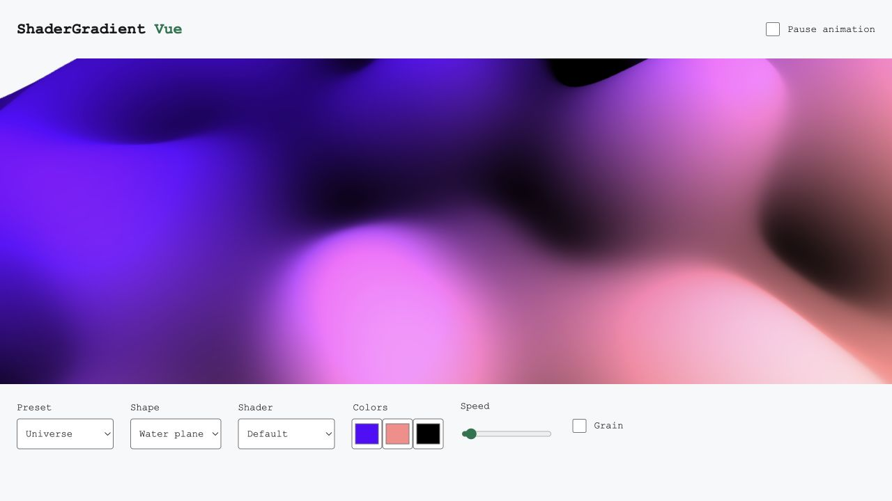

# LuxLeaf Gradient Studio — source guide

**Explore the full gradient renderer, React/Vue examples, editor UI and plugin source.**

[Quick start](#quick-start) · [React usage](#react-usage) · [Vue usage](#vue-usage) · [Examples and packages](#examples-and-packages) · [Verification](#verification)



*Actual local run of the original Vue application. The original [README](UPSTREAM.md) and [animated introduction](assets/intro.gif) remain available.*

This guide covers the restored monorepo on `faithful-upstream` in [PR #1](https://github.com/Zontafor/luxleaf-gradient-studio/pull/1). It retains upstream workspace names. For the published `@zontafor/luxleaf-gradient-studio` package, use the [main-branch guide](https://github.com/Zontafor/luxleaf-gradient-studio/blob/main/README.md).

## Quick start

Use Node 24.11+ for the Nuxt applications and pnpm 10.12.4 for this workspace.

```sh
git clone --branch faithful-upstream https://github.com/Zontafor/luxleaf-gradient-studio.git
cd luxleaf-gradient-studio
pnpm install --frozen-lockfile --ignore-scripts
pnpm --filter @shadergradient/react --filter @shadergradient/vue build
pnpm --filter example-vue-dev dev
```

Open the Vite URL printed in the terminal. Change presets, geometry, shader, colors, speed and grain using the original example controls.

## React usage

Inside a React workspace example, import the original package exports:

```tsx
import { ShaderGradientCanvas, ShaderGradient } from '@shadergradient/react';

export function GradientExample() {
  return (
    <div style={{ height: 420 }}>
      <ShaderGradientCanvas style={{ width: '100%', height: '100%' }} pixelDensity={1.5}>
        <ShaderGradient type="waterPlane" shader="defaults"
          color1="#114d40" color2="#b2d8b4" color3="#e2be6b"
          uSpeed={0.3} uStrength={3} lightType="3d" grain="off" />
      </ShaderGradientCanvas>
    </div>
  );
}
```

Match React and Fiber major versions as described in the [original compatibility matrix](UPSTREAM.md#compatibility-matrix). The locked workspace examples supply their own dependencies; do not replace all examples' React versions with one assumed version.

## Vue usage

In a Vue single-file component inside the Vue example:

```vue
<script setup lang="ts">
import { ShaderGradientCanvas, ShaderGradient } from '@shadergradient/vue';
</script>

<template>
  <div style="height: 360px">
    <ShaderGradientCanvas style="width: 100%; height: 100%">
      <ShaderGradient type="plane" color1="#114d40" color2="#b2d8b4"
        color3="#e2be6b" :u-speed="0.3" light-type="3d" grain="off" />
    </ShaderGradientCanvas>
  </div>
</template>
```

See the [Vue/Nuxt guide](packages/shadergradient-vue/README.md) for SSR fallback and lifecycle details.

## Examples and packages

| Area | What it contains | Source |
|---|---|---|
| React renderer | Mesh, shader, light and camera behavior | [Package](packages/shadergradient) |
| Vue renderer | Vue components and SSR-aware canvas | [Package](packages/shadergradient-vue) |
| UI | Controls, presets and GIF-related code | [UI](packages/ui) |
| Vue development app | Live parameter controls | [Example](apps/example-vue-dev) |
| Next.js development app | React examples, including loop controls | [Example](apps/example-nextjs-dev) |
| Standalone starters | React, Vue and Nuxt projects | [Starter guide](apps/examples/README.md) |
| Figma plugin | Editor integration source | [Plugin](apps/figma-plugin) |
| Framer plugin | Editor integration source | [Plugin](apps/framer-plugin) |

Plugin source and successful compilation do not mean the plugins are installed or published in an editor marketplace.

## Verification

```sh
node .luxleaf/verify-source.mjs
pnpm --filter @shadergradient/react --filter @shadergradient/vue build
pnpm --filter ui build
pnpm --filter @shadergradient/figma-plugin plugin:build
pnpm --filter @shadergradient/framer-plugin --filter example-vue-dev build
```

The original [browser-suite guide](tests/browser/README.md) explains separate end-to-end checks. [Recorded build verification](.luxleaf/verification.json) and [current GitHub runs](https://github.com/Zontafor/luxleaf-gradient-studio/actions) show their scope. The unmodified Next.js example has known lint errors; its build is not claimed to pass.

## Source and license

Pinned revision: `68bdd740037a11c639f8b91fd775949c71d718d0`. All 606 original files are covered by the [source manifest](.luxleaf/upstream-manifest.json), including relocated original workflows. Original license declarations, authorship and embedded third-party notices remain intact; see the [upstream license section](UPSTREAM.md#license).
