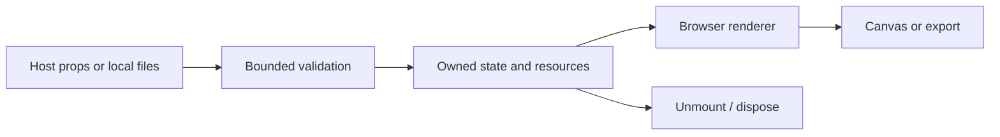

# Architecture — v0.2.0

### Complete source reference

The 606-file pinned reference tree preserves packages, apps, shaders, examples, integration sources, tests and documentation. It is licensed foundation material, not newly authored LuxLeaf code.

### Active engines

`/react` builds the pinned 2.4.24 source with a documented query-string ESM compatibility patch. `/vue` exposes the complete 0.1.0 package. Three.js is pinned to the tested 0.180.0 version.

### LuxLeaf studio

Strict versioned settings, bounded share URLs, undo/redo, interpolation, mesh/shader controls, PNG export, all twelve shader pairs at `/shaders`, a Framer host adapter, and an offline Figma PNG import integration.

### Remaining host verification

The Figma and Framer adapters have not been exercised in their actual editor hosts. Third-party HDR maps may require host-provided assets/network access; the demonstrated workbenches use local 3D lighting. Auxiliary type exports use published 2.4.20 definitions; current component/option types come from pinned source.

## Processing flow



## Foundation boundary

LuxLeaf extension code lives in `src/`. Permitted reference source is preserved separately where included. Host-specific adapters are separate entry points. The browser library does not supply application-wide authorization or tenant isolation.

## Earlier core design notes

# LuxLeaf Gradient Studio: architecture

```text
Validated preset → original GLSL uniforms → fullscreen WebGL2 triangle → local canvas → optional PNG Blob
```

The fragment shader combines continuous sine/cosine fields, coordinate warping, three-color blending and optional grain. Plane, orb and ribbon are distinct procedural treatments in that shader. No external textures, remote scripts or upstream shader assets are loaded. React is used by the optional component adapter; the renderer itself uses browser WebGL directly.

`Surface` owns a WebGL2 program, shader compilation, frame scheduling, resize observation and graphics cleanup. DPR is capped at 2 and each buffer dimension at 4096. Animation pauses for reduced-motion preference, document invisibility and non-intersecting canvases. Explicit updates still render a static frame. Time steps are capped at 50 ms to avoid a large jump after interruption.

Context loss cancels animation. Restoration recompiles the program, reapplies saved uniforms and resumes according to the current motion policy. A shader failure or unavailable WebGL leaves a solid first-palette-color CSS fallback. Context restoration handlers are implemented; real device loss/restoration is not part of the release's browser checks. A permanently lost context should be recreated by the host.

PNG export uses the current canvas buffer, which is preserved deliberately. That favors reliable local export over maximum throughput. No video export, frame queue or remote rendering service is included. Large multi-canvas pages should mount only visible surfaces; capped dimensions are not a measured performance guarantee.

## Trust boundary

Preset JSON enters a strict whitelist validator before it changes rendering state. The library does not evaluate code, render imported HTML, request credentials or contact an application backend. Dependencies are pinned in the lockfile; preserved runtime license texts ship in `third_party/`. Treat dependency installation as a separate network operation from running the demo.

## Integration with LuxLeaf's wider system

This package belongs in the presentation layer. Keep provider credentials, authorization, metering, workflow execution and document access on the existing server side. Store only validated, bounded presets through the host application's authorized tenant-scoped API. Do not infer permissions from visual state or embed secrets in presets. That API connection is an integration contract, not a backend implemented by this repository.

Build the library as ESM and bundle it with the authorized host application. The included demo is a static build in `demo-dist/`; an approved internal static host can serve it. No infrastructure is automatically provisioned and no cloud credentials are required.
